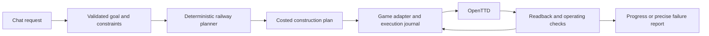

# OpenTTD Copilot

Build and operate transport networks in your OpenTTD company through conversation.

The first target is a request like:

> Build a railway carrying coal from Pronnington Coal Mine to Frenwood Power Station. Wait for a full load at the mine and use the money my company already has.

Success means an affordable railway, suitable stations and train, correct orders, and observed coal deliveries. Construction commands returning successfully are only part of that result.

**Talk to an actual AI about your live game.** The local launcher connects your
signed-in GitHub Copilot CLI to an isolated OpenTTD map. Ask about businesses,
money, trains and orders; compare read-only construction quotes; then explicitly
authorize a supported railway. It uses your Copilot allowance, not a new API key.

```sh
python3 -B tools/game_chat.py
```

Try: "Compare the Canley and Hunninghead coal mines for supplying Canley Power
Station. Budget 50000, keep 10000 reserve, full load. Don't build yet."
Then "Build the Canley option." The AI resolves actual observed businesses;
deterministic code owns geometry, prices, execution and delivery verification.

The current bridge cannot read train profit, production rates or station queues:
optimization suggestions are not measured profit forecasts. Construction is
still one flat-clear standard-coal line, at most 50 rail tiles. The older
`tools/play_native.py` is a fixed-command, model-free alternative, not AI chat.
See [launch, permissions, saves and limits](docs/NATIVE_PLAYABLE_ALPHA.md).

GitHub: [CaptainCucumber/openttd-copilot](https://github.com/CaptainCucumber/openttd-copilot) (private repository).

## Project records

| Record | Purpose |
|---|---|
| [Current status](docs/STATUS.md) | What is done, what is unproven, and the next concrete tasks |
| [Project plan](docs/PROJECT_PLAN.md) | Requirements, scope, milestones, dependencies, and risks |
| [Architecture](docs/ARCHITECTURE.md) | How intent, planning, game control, and verification fit together |
| [Acceptance tests](docs/ACCEPTANCE.md) | What we must demonstrate in the real game |
| [Research](docs/RESEARCH.md) | Findings from OpenTTD and the two reference projects, with pinned sources |
| [Decision log](docs/DECISIONS.md) | Choices, assumptions, and conditions for revisiting them |
| [Work log](docs/WORK_LOG.md) | Dated actions, results, and handoffs |
| [M1 adapter report](docs/M1_REPORT.md) | Capability evidence, stock limitations, and the selected production boundary |
| [M2a bridge report](docs/M2A_REPORT.md) | Native identity protocol, copied-save evidence, and the M2b boundary |
| [M2b mutation report](docs/M2B_REPORT.md) | Single-piece mutation, saved outcome evidence, and recovery limits |
| [M2c vehicle report](docs/M2C_REPORT.md) | Vehicle-tagged full departures and deliveries in the isolated fixture |
| [M2d tile report](docs/M2D_TILE_REPORT.md) | Bounded read-only tile data for the future planner |
| [M2d sequence report](docs/M2D_SEQUENCE_REPORT.md) | Sequential capped native rail commands and retained outcomes across reload |
| [M2d infrastructure report](docs/M2D_INFRASTRUCTURE_REPORT.md) | Capped native station/depot construction, created IDs, and save migration |
| [M2d train purchase report](docs/M2D_TRAIN_PURCHASE_REPORT.md) | Capped rail vehicle purchase, actual IDs, and replay/reload |
| [M2d train configuration report](docs/M2D_TRAIN_CONFIGURATION_REPORT.md) | Native wagon attachment, full-load/delivery orders, explicit start/stop, and replay/reload |
| [Native railway report](docs/M2D_NATIVE_RAILWAY_REPORT.md) | Existing-business route, whole-job budget, native service, visible MCP and replay evidence |

Start each development session with `docs/STATUS.md`. Update the status and work log as work progresses; record substantial design changes in the decision log. These files are the project's durable memory.

## Direction



Prove control of the player's company first, then build a complete railway from a structured request, then add natural language. The first adapter experiment targeted stock OpenTTD 15.3 through GameScript and its Admin interface. M1 measured essential gaps and selected a small engine integration. M2a–M2c established identity, one typed mutation, and vehicle-tagged service observations; the first M2d slice adds tile data. See the [engine fork and build instructions](engine/README.md).

The first implementation checkpoint is an isolated rail/station control probe. See [running and inspecting the probe](docs/CONTROL_PROBE.md) and [current verification status](docs/STATUS.md). It uses the installed OpenTTD binary, copied graphics, and disposable profiles.

The next checkpoint also verifies bounded Admin requests and recovery across disconnects, pause, and save reloads. See [running the lifecycle probe](docs/LIFECYCLE_PROBE.md).

The five-world stock-adapter throughput checkpoint is documented in [the M1 throughput probe](docs/THROUGHPUT_PROBE.md).

The older controlled demo uses a separate local stdio MCP server. Configure a
compatible MCP host to launch `tools/mcp_server.py` from this checkout, then
ask it to open the demo map, build a coal railway between a coal mine and power
station with full-load departures, and poll `get_build_status`. The server
opens a new disposable map and, after the build tool is called, runs the
existing real-engine demo and opens the completed save. See
[the playable demo guide](docs/MCP_PLAYABLE_DEMO.md) for configuration and
scope.

The older fixture-only rule-based CLI remains available:

```sh
python3 -B tools/copilot_chat.py
```

It opens the same controlled fixture. Neither demo attaches to or modifies
normal saves. The standalone CLI is not an LLM; the MCP option lets the
connected AI client handle conversation while the deterministic backend
validates the narrow supported intent.
