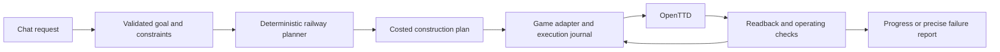

# OpenTTD Copilot

Build and operate transport networks in your OpenTTD company through conversation.

The first target is a request like:

> Build a railway carrying coal from Pronnington Coal Mine to Frenwood Power Station. Wait for a full load at the mine and use the money my company already has.

Success means an affordable railway, suitable stations and train, correct orders, and observed coal deliveries. Construction commands returning successfully are only part of that result.

**Status: company-control and rail-only transport/lifecycle probes tested in OpenTTD 15.3. No route planner or conversational Copilot yet.**

GitHub: [CaptainCucumber/openttd-copilot](https://github.com/CaptainCucumber/openttd-copilot) (private repository).

## Project records

| Record | Purpose |
|---|---|
| [Current status](docs/STATUS.md) | What is done, what is unproven, and the next concrete tasks |
| [Project plan](docs/PROJECT_PLAN.md) | Requirements, scope, milestones, dependencies, and risks |
| [Architecture](docs/ARCHITECTURE.md) | How intent, planning, game control, and verification fit together |
| [Acceptance tests](docs/ACCEPTANCE.md) | What we must demonstrate in the real game |
| [Research](docs/RESEARCH.md) | Findings from OpenTTD and the two reference projects, with pinned sources |
| [Decision log](docs/DECISIONS.md) | Choices, assumptions, and conditions for revisiting them |
| [Work log](docs/WORK_LOG.md) | Dated actions, results, and handoffs |

Start each development session with `docs/STATUS.md`. Update the status and work log as work progresses; record substantial design changes in the decision log. These files are the project's durable memory.

## Direction



Prove control of the player's company first, then build a complete railway from a structured request, then add natural language. The first adapter experiment targets the installed OpenTTD 15.3 through GameScript and its Admin interface. A small engine integration remains an option if that approach fails the capability or performance checks.

The first implementation checkpoint is an isolated rail/station control probe. See [running and inspecting the probe](docs/CONTROL_PROBE.md) and [current verification status](docs/STATUS.md). It uses the installed OpenTTD binary, copied graphics, and disposable profiles.

The next checkpoint also verifies bounded Admin requests and recovery across disconnects, pause, and save reloads. See [running the lifecycle probe](docs/LIFECYCLE_PROBE.md).

The first local chat seam is now available for the supported disposable coal
fixture. It is deliberately model-free while the deterministic route builder is
being completed:

```sh
python3 -B tools/copilot_chat.py
```

Enter `Build a railway carrying coal from a coal mine to a power station. Wait
for a full load.`, then type `build`. The command runs the isolated OpenTTD
vehicle probe and opens the completed disposable save in the OpenTTD window so
you can watch the route and train. It does not attach to or modify normal
saves. Unsupported requests are rejected before any game action. Use
`--no-show` when running without a graphical session.
