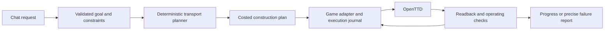

# OpenTTD Copilot

Build and operate transport networks in your OpenTTD company through conversation.

The first target is a request like:

> Build a railway carrying coal from Pronnington Coal Mine to Frenwood Power Station. Wait for a full load at the mine and use the money my company already has.

Success means an affordable railway, suitable stations and train, correct orders, and observed coal deliveries. Construction commands returning successfully are only part of that result.

**Talk to an actual AI about your live game.** The local launcher connects your
signed-in GitHub Copilot CLI to an isolated OpenTTD map. Ask about businesses,
money, trains and orders; compare read-only construction quotes; then explicitly
authorize a supported bus service or railway. It uses your Copilot allowance,
not a new API key.

```sh
python3 -B tools/game_chat.py
```

New games use an ordinary randomly seeded 256x256 map with towns, hills, water
and trees. `--save /absolute/path/world.sav` plays a copy of an existing world.
The old flat seed-6 coal map is now explicit: `--map-style railway-fixture`.

**Bus testing point:** one line can now visit multiple towns, and new town
stops can be inserted into an existing bus's orders without replacing its bus,
depot or old stops. Three-town service and same-bus middle insertion have
real-engine passenger/reload/replay evidence. This remains bounded, not a
random-map reliability or profitability claim. See [current status](docs/STATUS.md).

Try: "Which nearby towns could we connect with a passenger bus? Budget 50000,
keep 10000 reserve. Compare plans, don't build yet."
Then authorize the chosen service. The AI resolves actual observed towns/businesses;
deterministic code owns geometry, prices, execution and delivery verification.

The current bridge cannot read train profit, production rates or station queues:
optimization suggestions are not measured profit forecasts. Bus services use
2-8 ordered town stops, a connected road depot, one bus and ordinary orders; bounded
road links/tree clearing are quoted before construction. No bridges, terrain
editing or house demolition. Railway construction retains its flat-clear
standard-coal/50-rail limit. The shared native history is limited to 64 operations.
Adding stops initially supports a running owned bus with unshared ordinary
orders. Ask where to insert the stop; shared orders and automatic extra buses
remain unsupported.
The older
`tools/play_native.py` is a fixed-command, model-free alternative, not AI chat.
See [launch, permissions, saves and limits](docs/NATIVE_PLAYABLE_ALPHA.md).

GitHub: [CaptainCucumber/openttd-copilot](https://github.com/CaptainCucumber/openttd-copilot) (private repository).

## Project records

| Record | Purpose |
|---|---|
| [Current status](docs/STATUS.md) | What is done, what is unproven, and the next concrete tasks |
| [Project plan](docs/PROJECT_PLAN.md) | Requirements, scope, milestones, dependencies, and risks |
| [Architecture](docs/ARCHITECTURE.md) | How intent, planning, game control, and verification fit together |
| [Acceptance tests](docs/ACCEPTANCE.md) | What we must demonstrate in the real game |
| [Research](docs/RESEARCH.md) | Findings from OpenTTD and the two reference projects, with pinned sources |
| [Decision log](docs/DECISIONS.md) | Choices, assumptions, and conditions for revisiting them |
| [Work log](docs/WORK_LOG.md) | Dated actions, results, and handoffs |
| [M1 adapter report](docs/M1_REPORT.md) | Capability evidence, stock limitations, and the selected production boundary |
| [M2a bridge report](docs/M2A_REPORT.md) | Native identity protocol, copied-save evidence, and the M2b boundary |
| [M2b mutation report](docs/M2B_REPORT.md) | Single-piece mutation, saved outcome evidence, and recovery limits |
| [M2c vehicle report](docs/M2C_REPORT.md) | Vehicle-tagged full departures and deliveries in the isolated fixture |
| [M2d tile report](docs/M2D_TILE_REPORT.md) | Bounded read-only tile data for the future planner |
| [M2d sequence report](docs/M2D_SEQUENCE_REPORT.md) | Sequential capped native rail commands and retained outcomes across reload |
| [M2d infrastructure report](docs/M2D_INFRASTRUCTURE_REPORT.md) | Capped native station/depot construction, created IDs, and save migration |
| [M2d train purchase report](docs/M2D_TRAIN_PURCHASE_REPORT.md) | Capped rail vehicle purchase, actual IDs, and replay/reload |
| [M2d train configuration report](docs/M2D_TRAIN_CONFIGURATION_REPORT.md) | Native wagon attachment, full-load/delivery orders, explicit start/stop, and replay/reload |
| [Native railway report](docs/M2D_NATIVE_RAILWAY_REPORT.md) | Existing-business route, whole-job budget, native service, visible MCP and replay evidence |
| [Town bus report](docs/M2E_TOWN_BUS_REPORT.md) | Ordinary-map bus service evidence, integration gates and bounded road scope |
| [M2f local bridge plan](docs/M2F_LOCAL_BRIDGE_PLAN.md) | F1 dispatcher verified; single-process endpoint and remaining work packages planned |

Start each development session with `docs/STATUS.md`. Update the status and work log as work progresses; record substantial design changes in the decision log. These files are the project's durable memory.

## Direction



The direction is a **player-directed transport companion**, not an autonomous
company president: discuss the live game, compare grounded options, then
construct only the explicitly requested service within its cap and reserve.
Natural language chooses goals; deterministic code chooses geometry, vehicles,
prices and execution; the engine and independent readback establish results.

The native coal-railway path is demonstrated. The active M2e expansion adds
town passenger buses and ordinary maps, with its bounded clean-engine exit
demonstrated. The playtest follow-up adds ordered multi-town bus lines and
explicit stop insertion (D033). Next: reliability on varied supported
roads/maps and interrupted jobs (M3), richer production/queue/profit observations
and grounded conversational advice (M4), then restart/resume and reproducible
local-alpha packaging (M5). Before M3, M2f moves Copilot into one
single-player game process (no server/client pair) — local games only, per
[D032](docs/DECISIONS.md#d032---host-the-native-bridge-in-the-single-player-game-process).
F1's transport-neutral dispatcher is verified against real coal/bus
services and reload/replay; the product still uses server/client until
F2-F7 pass. These remaining milestones are proposed deliverables, not implemented
general terrain, measured optimization or unrestricted transport support.
See [milestone sequencing](docs/PROJECT_PLAN.md#next-milestone-sequencing)
and the [engine fork/build instructions](engine/README.md).

## Historical checkpoints

The initial stock GameScript/Admin experiment measured essential gaps and
selected the narrow native engine bridge. The following probes and controlled
demos retain their original scope; they are not the current normal-map launcher.

The first implementation checkpoint is an isolated rail/station control probe. See [running and inspecting the probe](docs/CONTROL_PROBE.md) and [current verification status](docs/STATUS.md). It uses the installed OpenTTD binary, copied graphics, and disposable profiles.

The lifecycle checkpoint verifies bounded Admin requests and recovery across disconnects, pause, and save reloads. See [running the lifecycle probe](docs/LIFECYCLE_PROBE.md).

The five-world stock-adapter throughput checkpoint is documented in [the M1 throughput probe](docs/THROUGHPUT_PROBE.md).

The older controlled demo uses a separate local stdio MCP server. Configure a
compatible MCP host to launch `tools/mcp_server.py` from this checkout, then
ask it to open the demo map, build a coal railway between a coal mine and power
station with full-load departures, and poll `get_build_status`. The server
opens a new disposable map and, after the build tool is called, runs the
existing real-engine demo and opens the completed save. See
[the playable demo guide](docs/MCP_PLAYABLE_DEMO.md) for configuration and
scope.

The older fixture-only rule-based CLI remains available:

```sh
python3 -B tools/copilot_chat.py
```

It opens the same controlled fixture. Neither demo attaches to or modifies
normal saves. The standalone CLI is not an LLM; the MCP option lets the
connected AI client handle conversation while the deterministic backend
validates the narrow supported intent.
